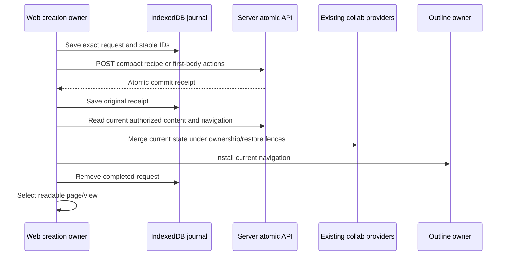

# Atomic object creation in Web

Default Document and Database pages, Database views, and the page of an existing
Database Row use the server atomic APIs. Ordinary Add Row keeps the existing
client-side Yjs/sync implementation. Opening row detail, side peek, or a full row
page initializes a missing Document on the server before exposing its editor.

Web requires connectivity and the server-info flags `enable_atomic_creation` and
`enable_atomic_creation_defaults` to be literally `true`, including self-hosted
servers. Unsupported servers do not fall back to partial legacy creation.

## Production boundaries

| Boundary | Responsibility | Direct tests |
| --- | --- | --- |
| `application/atomic-creation` | Account/workspace ownership, immutable durable request, receipt validation and exact recovery | `atomic-creation.test.ts`, `receipt.test.ts` |
| `http/page-default-creation` | Compact page recipes and exact supplied-ID recovery | `page-default-creation.test.ts`, `page-default-creation-recovery.test.ts` |
| `http/created-page-hydration` | Current content and Folder validation, versioned provider handoff | `created-page-hydration.test.ts`, `created-page-hydration.integration.test.ts` |
| `database-yjs/creation` | Live and persisted source readiness, compact view recipe, restore-safe current hydration | `database-view-source-readiness.test.ts`, `default-database-view-creation.test.ts`, `linked-default-view-creation.test.ts` |
| `row-document` initialization and recovery | Server default schema on open, shared concurrent initialization, exact pending authored-command recovery, current Row/Document hydration | `first-body-actions.test.ts`, `first-body-owner.test.ts`, `first-body-editor.test.ts`, `first-body-files.test.ts`, `first-body-staging.test.ts`, `first-body-persistence.test.ts`, `first-body-checkpoint.test.ts`, `atomic-first-body.test.ts` |
| `row-document/template-document` | Explicit template initialization and exact pending-command recovery before exposing the editor | `template-document.test.ts`, `row-source-readiness.test.ts`, `DatabaseTemplateButton.test.tsx` |
| App/editor callers | Selection after current navigation; explicit pending-page recovery | `PendingPageCreations.test.tsx`, `usePageOperations.publish.test.tsx`, `AddPageActions.test.tsx`, `DatabaseRowSubDocument.test.tsx` |

The receipt proves the original commit, not present-day access or current content.
Recovery reads current state; it never replays an old receipt delta over newer
settings or restored data. A failed or ambiguous operation keeps its exact request.
Pending page commands have an explicit retry control in their original workspace.
Database-view retries belong to the source operation, and row-page retries belong
to the original row. Row initialization runs on opening; if reconnect remounts the
open row, that new opening may recover its saved command. Other creation commands
retain their explicit retry controls.

Authentication refresh preserves the same-tab login lifetime. Logout, replacement
account/workspace, retired provider and restore generation changes reject stale
publication. The HTTP adapter checks ownership immediately before sending, including
after asynchronous token refresh. An external token replacement in another tab
conservatively invalidates in-flight work; its saved request remains recoverable.

DatabaseView source readiness checks both live and persisted Yjs state, including
deletions, against the server. It does not force a whole-workspace upload. New
List/Gallery/Feed creation requests the final layout directly, removing temporary
Grid creation, conversion and compensation calls.

All nine Database layouts use compact server recipes for new, added, duplicated,
and linked views. The server persists their fields and settings, including Board
group columns; the client does not finish the schema after creation. A read-only
Board fallback remains for legacy schemas and older receipts. After commit,
current Database content and Folder metadata load concurrently under the same
deadline. Both must pass the final identity, ownership, restore and storage checks
before the new view is selected. A barrier-based component test verifies the
overlap without asserting machine-dependent latency.

Page appends use the server's `end` position. Middle insertions retain the previous sibling as an
`after` anchor, which requires server support for that position variant. Navigation children omit
trashed or unreadable entries and must never be converted into raw Folder indexes. The server
resolves anchors under its topology lock and rejects a sibling that has moved out of the parent.

## Row-page opening and content indicator

An explicitly opened row (side/center peek or full page) loads through the existing
canonical row sync owner without waiting for the database-wide seed preload. A
Pending blob diff can defer its next batch request for five seconds; that background
wait must not delay the selected row's metadata or document creation. Other rows
keep the batched path, including related rows requested from the open page.
`Database.prefetch-lifecycle.test.tsx` checks this priority, deduplication and
workspace changes; `atomic-row-document.spec.ts` holds the bulk response while the
user opens, edits and reopens the selected row.

A missing writable row page uses `contribution: { kind: "default_schema",
schema_version: "v1" }`. The server owns the blank schema; Web sends no document
body or synthetic text action. Loading remains visible until the receipt, current
Row/Document state, version/restore checks and provider persistence are complete.
The editor never mounts a detached blank draft. Existing documents use the normal
read path, and read-only or published surfaces do not initialize missing pages.

Offline opening shows an inline connectivity error with Retry. Failed creation
retains its immutable journal command and shows Retry without an editor; permission
denial shows no access. Reopening a row recovers a pending command before testing
whether its document exists. Concurrent opens share the same active initialization.

A newly added ordinary row may still be syncing. Initialization waits for the
server to read that Row and its source-view membership within the same 30-second
attempt budget. It never forces an upload or changes ordinary Add Row behavior.
An explicit server `RetryLater` response retries the same immutable request within
that budget; ambiguous transport failures retain the command for recovery.

Document existence does not mean authored content. A blank schema preserves the
Row's empty content state (an absent flag also means empty). Database views render
the document icon from `is_document_empty` in their existing Row metadata; opening
a database does not fetch row bodies to decide which icons to show. The active
editor publishes only content-state transitions after local edits, including
manual commands and undo/redo. Adding content shows the icon, clearing it hides
the icon, and the Document remains available. Title/property edits, passive
hydration and remote updates do not publish a new content flag. Pending metadata
is flushed when closing immediately after an edit.

Previously saved authored first-body commands and staged edits remain recoverable.
Their compiler preserves supported nested blocks and text marks; hydration checks
staged edits against current canonical content and retains conflicts for recovery.
Document bytes and the recovery marker commit in one transaction on the existing
Document provider, and current Row metadata is persisted before journal cleanup.
Provider writes own their IndexedDB transactions so seeded rows cannot inherit an
unrelated transaction that lacks access to the update table.

## Template editor initialization

New Template and editing a template with no document explicitly initialize a blank
server Document before opening the editor. This permits an embedded database as a
template's first block. Ordinary row pages use the same initialization boundary.

Template initialization sends the same compact `default_schema` contribution.
No encoded body or empty `ApplyTextDelta` is supplied, and initialization does not
mark the Row nonempty. The real server contract test checks the empty body, Row
metadata, readable registration and exact replay. Pending authored commands are
recovered before testing whether the body exists.
Template saves derive emptiness from the current document content. A successfully
materialized blank body must not turn a property-only or decoration-only template
into an authored page, or add a page-content indicator to rows created from it.

Template source rows intentionally do not appear in normal row ordering. Readiness
accepts a matching canonical template registry record, including the deterministic
document identity, within the current database and view. An editor UI flag alone
does not establish source membership. Ownership is captured before asynchronous
preparation and checked again before exposing the editor.

## Scope and validation

Authored `page_data` imports, templates and copies retain their explicit content
paths; this change never substitutes a blank default recipe for supplied content.
It does not migrate every authored-content workflow to the new endpoints.

Run focused Jest suites with `pnpm exec jest --runInBand --no-coverage --runTestsByPath`.
`playwright/e2e/page/atomic-creation.spec.ts` exercises real server publication,
lost-acknowledgement recovery, sidebar/content selection, database views, row-page
initialization, and ordinary offline Add Row using an isolated account/browser context.

The related browser coverage includes these separate behavior boundaries:

| Browser tests | Visible behavior checked |
| --- | --- |
| `page/create-delete-page`, `space/create-space`, `page/subpage-creation`, `app/view-modal` | Exact created IDs, title and content, modal/full-page activation, sidebar, reload, deletion and stable retry |
| `page/atomic-creation-admission` | Offline and unavailable-server refusal for Document and Database without changing the open content or selection |
| `database/atomic-database-layouts` | All nine native layouts, including Timeline; matching tab, sidebar and rendered content after reload |
| `database/atomic-database-view` | All nine added layouts, server schema before receipt delivery, held source reads, exact lost-ACK retry, sidebar/content agreement, linked view identity, offline and capability refusal |
| Existing database view tabs/consistency/container and linked-database tests | Normal view actions, cross-layout row consistency and embedded navigation |
| `database/atomic-row-document`, existing `database/row-document` | Create-on-open with held acknowledgement, ordinary new rows, exact retry and reload recovery, offline refusal, empty/add/clear/undo/redo indicators, no body reads for database icons, continuous typing/focus, bookmark paste and persistence |
| Existing row-template and database-copy tests | Template body/defaults, property-only rows, embedded and linked databases, row/document copying and reload |

The authentication test helper applies explicitly supplied `APPFLOWY_BASE_URL`,
`APPFLOWY_GOTRUE_BASE_URL`, and `APPFLOWY_WS_BASE_URL` only to the disposable browser
context. With `BASE_URL` pointing at the test Web build, run selected specs using
`pnpm exec playwright test <spec paths> --workers=1`. For concurrent implementation,
test an immutable `NODE_ENV=test` build so hot reload cannot invalidate React contexts
mid-scenario. A listed scenario is coverage intent; inspect its actual run result
before treating it as acceptance evidence.

Hosted Timeline cases grant an active Pro fixture only to their fresh test workspace.
Set `APPFLOWY_TEST_POSTGRES_CONTAINER` to the disposable server database container
and `APPFLOWY_TEST_POSTGRES_DATABASE` when its test database differs from the container
default. Browser tests stub the separate billing service's display responses while
retaining real server-info capabilities and backend entitlement checks.

Multi-layout fixtures must respect the server's configured database view-count
limit. Exercise layouts in separate databases or remove already-checked views;
do not raise server limits to make a creation test pass. Capture UI screenshots
after creation notices, row loaders and transitional dialogs have settled, and
assert layout-specific rendered content before and after reload.
Template graph tests also need the test stack's Search service for page-reference
suggestions. A mention response with failed sections and `partial: true` is a
dependency failure, not proof that the referenced page is absent.

The three opt-in `.integration.test.ts` contracts use `APPFLOWY_ATOMIC_INTEROP_FIXTURE`
pointing to private JSON with a test-owned local server URL, token and workspace.
They verify page cache hydration, DatabaseView settings/membership, and native row-body
actions against a real server. They are not
an implicit dependency of the regular unit-test run. Never point validation at an
existing user's stored browser or app settings.

Use `pnpm lint` and `pnpm build` for the repository checks. Browser phase timings
are exploratory end-to-end observations, not a capacity benchmark or a measured
before/after speedup. Component tests enforce call counts and ordering rather than
machine-dependent timing thresholds.
