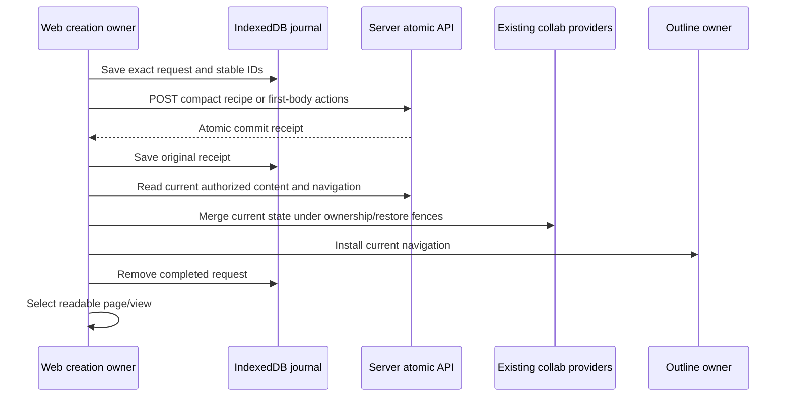

# Atomic object creation in Web

Default Document and Database pages, Database views, and the first body of an
existing Database Row use the server atomic APIs. Ordinary Add Row keeps the
existing client-side Yjs/sync implementation. Opening an empty row page does not
create a server Document; its first completed editor command does.

Web requires connectivity and the server-info flags `enable_atomic_creation` and
`enable_atomic_creation_defaults` to be literally `true`, including self-hosted
servers. Unsupported servers do not fall back to partial legacy creation.

## Production boundaries

| Boundary | Responsibility | Direct tests |
| --- | --- | --- |
| `application/atomic-creation` | Account/workspace ownership, immutable durable request, receipt validation and exact recovery | `atomic-creation.test.ts`, `receipt.test.ts` |
| `http/page-default-creation` | Compact page recipes and exact supplied-ID recovery | `page-default-creation.test.ts`, `page-default-creation-recovery.test.ts` |
| `http/created-page-hydration` | Current content and Folder validation, versioned provider handoff | `created-page-hydration.test.ts`, `created-page-hydration.integration.test.ts` |
| `database-yjs/creation` | Live and persisted source readiness, compact view recipe, restore-safe current hydration | `database-view-source-readiness.test.ts`, `default-database-view-creation.test.ts`, `linked-default-view-creation.test.ts` |
| `row-document` first-body components | Detached draft, complete-command seal, native BlockActions compiler, staged later edits, current Row/Document hydration | `first-body-actions.test.ts`, `first-body-owner.test.ts`, `first-body-editor.test.ts`, `first-body-files.test.ts`, `first-body-staging.test.ts`, `first-body-persistence.test.ts`, `first-body-checkpoint.test.ts`, `atomic-first-body.test.ts` |
| `row-document/template-document` | Explicit template initialization and exact pending-command recovery before exposing the editor | `template-document.test.ts`, `row-source-readiness.test.ts`, `DatabaseTemplateButton.test.tsx` |
| App/editor callers | Selection after current navigation; explicit pending-page recovery | `PendingPageCreations.test.tsx`, `usePageOperations.publish.test.tsx`, `AddPageActions.test.tsx`, `DatabaseRowSubDocument.test.tsx` |

The receipt proves the original commit, not present-day access or current content.
Recovery reads current state; it never replays an old receipt delta over newer
settings or restored data. A failed or ambiguous operation keeps its exact request.
Pending page commands have an explicit retry control in their original workspace.
Database-view retries belong to the source operation, and row-page retries belong
to the original row. Reconnect does not automatically submit commands.

Authentication refresh preserves the same-tab login lifetime. Logout, replacement
account/workspace, retired provider and restore generation changes reject stale
publication. The HTTP adapter checks ownership immediately before sending, including
after asynchronous token refresh. An external token replacement in another tab
conservatively invalidates in-flight work; its saved request remains recoverable.

DatabaseView source readiness checks both live and persisted Yjs state, including
deletions, against the server. It does not force a whole-workspace upload. New
List/Gallery/Feed creation requests the final layout directly, removing temporary
Grid creation, conversion and compensation calls.

All nine Database layouts use compact server recipes for new, added, duplicated,
and linked views. The server persists their fields and settings, including Board
group columns; the client does not finish the schema after creation. A read-only
Board fallback remains for legacy schemas and older receipts. After commit,
current Database content and Folder metadata load concurrently under the same
deadline. Both must pass the final identity, ownership, restore and storage checks
before the new view is selected. A barrier-based component test verifies the
overlap without asserting machine-dependent latency.

## Row-page command boundary

The first body is edited in a detached draft, without a canonical provider or early
Row nonempty/attribution writes. The owner flushes and seals the complete accepted
command, including IME completion or an accepted file upload. Typing continues while
the request is pending; later edits are saved as a separate journal attachment without
changing the original request. The compiler preserves supported nested blocks and
text marks and rejects owned subpage/database blocks before side effects.

Hydration checks staged edits against current canonical content before applying them.
It preserves unrelated remote edits and retains the pending command if a touched
value conflicts. The mounted editor keeps its identity and selection during handoff.
Document bytes and the recovery marker commit in one transaction on the existing
Document provider, and current Row metadata is persisted before journal cleanup.
Provider writes own their IndexedDB transactions, even when hydration schedules them
from another transaction. This prevents seeded rows from inheriting a transaction
that cannot access their update table.
Reopening a row with a saved command explicitly recovers that exact command and its
staged edits; reconnect alone does not submit it.

A newly added ordinary row may still be syncing. First-body creation waits for the
server to read that Row and its source-view membership within the same 30-second
attempt budget. It never forces an upload or changes ordinary Add Row behavior.
Readability can precede durable storage. An explicit server `RetryLater` response
retries the same immutable request within that budget; ambiguous transport failures
remain in the journal for deliberate recovery.

Once the command is compiled, its exact native actions are journaled before POST.
An upload that has not completed when the browser tab closes is not yet a durable
creation request. Existing body editing and ordinary row synchronization are unchanged.

## Template editor initialization

New Template and editing a template with no document explicitly initialize a blank
server Document before opening the editor. This permits an embedded database as a
template's first block. Opening an ordinary empty row remains lazy.

The existing v1 action API requires at least one action. Template initialization
sends an empty `ApplyTextDelta` for the versioned default text identity; the server
creates the blank schema. No encoded document body is supplied. The native server
contract test checks the empty body, Row metadata, readable registration and exact
replay. Pending commands are recovered before testing whether the body exists.
Template saves derive emptiness from the current document content. A successfully
materialized blank body must not turn a property-only or decoration-only template
into an authored page, or add a page-content indicator to rows created from it.

Template source rows intentionally do not appear in normal row ordering. Readiness
accepts a matching canonical template registry record, including the deterministic
document identity, within the current database and view. An editor UI flag alone
does not establish source membership. Ownership is captured before asynchronous
preparation and checked again before exposing the editor.

## Scope and validation

Authored `page_data` imports, templates and copies retain their explicit content
paths; this change never substitutes a blank default recipe for supplied content.
It does not migrate every authored-content workflow to the new endpoints.

Run focused Jest suites with `pnpm exec jest --runInBand --no-coverage --runTestsByPath`.
`playwright/e2e/page/atomic-creation.spec.ts` exercises real server publication,
lost-acknowledgement recovery, sidebar/content selection, database views, row first
body, and ordinary offline Add Row using an isolated account/browser context.

The related browser coverage includes these separate behavior boundaries:

| Browser tests | Visible behavior checked |
| --- | --- |
| `page/create-delete-page`, `space/create-space`, `page/subpage-creation`, `app/view-modal` | Exact created IDs, title and content, modal/full-page activation, sidebar, reload, deletion and stable retry |
| `page/atomic-creation-admission` | Offline and unavailable-server refusal for Document and Database without changing the open content or selection |
| `database/atomic-database-layouts` | All nine native layouts, including Timeline; matching tab, sidebar and rendered content after reload |
| `database/atomic-database-view` | All nine added layouts, server schema before receipt delivery, held source reads, exact lost-ACK retry, sidebar/content agreement, linked view identity, offline and capability refusal |
| Existing database view tabs/consistency/container and linked-database tests | Normal view actions, cross-layout row consistency and embedded navigation |
| `database/atomic-row-document`, existing `database/row-document` | Immediate first-body editing on newly added rows, exact retry, offline edit refusal, continuous typing/focus, bookmark paste, row indicator, close/reopen and persistence |
| Existing row-template and database-copy tests | Template body/defaults, property-only rows, embedded and linked databases, row/document copying and reload |

The authentication test helper applies explicitly supplied `APPFLOWY_BASE_URL`,
`APPFLOWY_GOTRUE_BASE_URL`, and `APPFLOWY_WS_BASE_URL` only to the disposable browser
context. With `BASE_URL` pointing at the test Web build, run selected specs using
`pnpm exec playwright test <spec paths> --workers=1`. For concurrent implementation,
test an immutable `NODE_ENV=test` build so hot reload cannot invalidate React contexts
mid-scenario. A listed scenario is coverage intent; inspect its actual run result
before treating it as acceptance evidence.

Hosted Timeline cases grant an active Pro fixture only to their fresh test workspace.
Set `APPFLOWY_TEST_POSTGRES_CONTAINER` to the disposable server database container
and `APPFLOWY_TEST_POSTGRES_DATABASE` when its test database differs from the container
default. Browser tests stub the separate billing service's display responses while
retaining real server-info capabilities and backend entitlement checks.

Multi-layout fixtures must respect the server's configured database view-count
limit. Exercise layouts in separate databases or remove already-checked views;
do not raise server limits to make a creation test pass. Capture UI screenshots
after creation notices, row loaders and transitional dialogs have settled, and
assert layout-specific rendered content before and after reload.
Template graph tests also need the test stack's Search service for page-reference
suggestions. A mention response with failed sections and `partial: true` is a
dependency failure, not proof that the referenced page is absent.

The three opt-in `.integration.test.ts` contracts use `APPFLOWY_ATOMIC_INTEROP_FIXTURE`
pointing to private JSON with a test-owned local server URL, token and workspace.
They verify page cache hydration, DatabaseView settings/membership, and native row-body
actions against a real server. They are not
an implicit dependency of the regular unit-test run. Never point validation at an
existing user's stored browser or app settings.

Use `pnpm lint` and `pnpm build` for the repository checks. Browser phase timings
are exploratory end-to-end observations, not a capacity benchmark or a measured
before/after speedup. Component tests enforce call counts and ordering rather than
machine-dependent timing thresholds.
