# Workspace permissions: Web review evidence

Screenshots of the workspace permission UI in Web PR #621 after the UX redesign: the Permissions
panel (who can create spaces, access to all spaces), the group dialog, Manage space (per-person
access and "Who can add pages to this space"), Create space, the account-only page, workspace
creation limits, live loss and recovery of page access, and the sign-out question.

**22 current captures were made on 2026-10-14** (one retaken on 2026-10-15) from the real Web app
against a real Cloud server on an isolated stack with synthetic data: 21 after a design review of the
first refresh (fixes listed below), of which 7 were taken again and 1 was added later the same day,
after four follow-up fixes that align Web with Desktop (also listed below); a second rerun after the
review of those fixes reproduced two of them byte for byte (also below); a third rerun on 2026-10-15
retook the account-only page against a newer server that sends the invited role, so it now says
"Invited as a guest" (also below). 15 earlier captures that still match the current
UI are kept and labelled historical; 11 captures of the old UI were removed. Hashes, viewers and the
server state read back after each run are in [capture-manifest.json](capture-manifest.json).

## How the current captures were made

| | |
| --- | --- |
| Date | 2026-10-14 (UTC); the account-only page was retaken on 2026-10-15 (UTC) |
| Web source | commit `bcfa8067` on `oodrive-fix/web-visual` (integration branch `codex/oodrive-permissions-fixes` at `b612fb90` plus the UI fixes below and the capture spec), served by the vite dev server. The rerun (the Permissions panel as owner and as member, and the refused Create space) used app source at commit `fde232d7` on `oodrive-fix/web-final` (the integration branch at `31cb5377` plus the four follow-up fixes below) with the capture spec and seed as committed in `3f0ef353` (the commit that also added the retaken images and this record; their hashes are in the manifest, and `fde232d7` alone does not contain them), served the same way. The second rerun (the refused Create space and the account-only page) used commit `8d29f0e3` on `oodrive-fix/web-final` (the above plus the review follow-ups below; app source and harness in that one commit), served the same way. The third rerun (the account-only page) used app source at the integration branch head `ef390b5b` on `oodrive-fix/web-guest-capture`, with the capture spec as committed together with the retaken image and this record, served the same way |
| Server source | AppFlowy Cloud Premium integration branch `codex/oodrive-permissions-fixes` at `59be2954e`. The binary was built at `540757ea9` with `cargo build --locked --bin appflowy_cloud --features commercial-local-test` (self-hosted feature set: three member seats, guests separate); the three commits since then change only tests and docs. Run with `APPFLOWY_ACCESS_CONTROL=true`. The rerun used the same binary (same hash; the stack's build record notes two uncommitted files at build time) while the branch had moved to `6dc8eec23`, whose only source change since (`b11f93934`, database duplicate authorization) does not touch these screens. The third rerun used the integration branch at `e2a01e66c`, whose invitation list sends the invited role, with the same self-hosted feature set: the `appflowy_cloud` executable of `cargo test --no-run --locked --test main --features commercial-local-test` from the branch's validation run (so test fixtures enabled by its dev-dependencies are compiled in, unused by the server; hash in the manifest). The default-feature build of that commit was started first, but a hosted build refuses the seed's installation policy and cannot restrict workspace creation, so nothing was captured with it |
| Stack | Isolated and synthetic: its own GoTrue (`appflowyinc/gotrue_premium:latest`), Redis, PostgreSQL database and MinIO bucket on loopback ports. No other environment, account or data was used. The Worker was not running (no imports or background jobs are shown). |
| Browser | Chromium 145 (Playwright build 1208, headless, so scrollbars are hidden), 1440×900, device scale 1. Each person was signed in with a GoTrue password grant stored as the app's session (not through the login screen). Requests to anything but the three stack origins were blocked. |
| Data | Created through the HTTP APIs only (GoTrue admin and Cloud REST) by [the seed](../../../support/permission-gallery-seed.ts). People use `@demo.test` addresses; nothing real is shown. |
| Permission changes | Made by the owner or the operator through the API. Questions opened in the UI were cancelled, lists of people to add were closed, and no setting was saved from the UI (the manifest's read-back shows the policy, the selections, HR's settings and group access unchanged). |

Reproduce on an isolated stack (the seed switches the installation's workspace creation policy, so
it refuses the usual developer ports):

```
APPFLOWY_PERMISSION_GALLERY=1 APPFLOWY_GALLERY_CLOUD=http://127.0.0.1:<cloud> \
APPFLOWY_GALLERY_GOTRUE=http://127.0.0.1:<gotrue> BASE_URL=http://127.0.0.1:<web> \
APPFLOWY_TEST_CHROMIUM_EXECUTABLE=<chromium> \
./node_modules/.bin/playwright test -c playwright.permission-gallery.config.ts
```

[permission-gallery.capture.spec.ts](../../../e2e/app/permission-gallery.capture.spec.ts) is
skipped without those variables. All 7 of its tests passed in the first run; the rerun ran 3 of its
now 8 tests (with `--grep`), and all 3 passed. The second rerun ran 2 of the 8: the refused Create
space into this folder, and the account-only page into a scratch folder to check its new assertion
against this server; both passed, and both images came out byte for byte the same as the committed
ones, so no image changed. The third rerun ran 1 of the 8, the account-only page, into this folder;
it passed, and only that image changed.

## The Demo workspace

| | |
| --- | --- |
| People | Olivia Martin (owner, the only person allowed to create workspaces), Alex Dupont and Sam Leroy (members). Jordan Petit has no workspace and one pending guest invitation to Demo: the three member seats of the self-hosted build are taken. |
| Groups | Users (Olivia, Alex; access to all spaces: Can view), HR (Olivia, Sam), Product (Olivia, Alex, Sam), Super_Users (Alex) |
| Who can create spaces | Owners and selected members: Alex and the Super_Users group |
| Workspace creation (installation) | Selected users; only Olivia is selected |
| General | Public, from the workspace template |
| HR | Custom, owned by Olivia. Space members: Can edit by default; everyone else: No access; only space owners add pages. HR group: Can edit; Users group: Can view; Alex keeps the space default. Sam can reach HR only through the HR group. |
| Product | Custom, created by Alex (a selected space creator). Product group: Can edit. Olivia's own row is an ordinary member with Can view. |
| Leadership | Private, Olivia's |

## Current captures (2026-10-14)

Each caption says what the image shows and what it does not prove. Where the spec asserted
something, that is stated; otherwise the image is only a picture of the UI.

**Permissions, as the owner.** The choices read from the most to the fewest people who can create
spaces, in the Desktop order: Owners and members, Owners and selected members, Owners only. "Who can
create spaces" is set to "Owners and selected members"; Alex and the Super_Users group are the
selections, under "Find members or groups to add". The
panel continues below: a fade over its bottom edge (the Access to all spaces summary) says so. The
spec checked that this card is the selected one and that both selections are listed. *Does not
prove* that the selections let anyone create a space (the API read back `can_create_space: true`
for Alex and `false` for Sam; see the manifest).

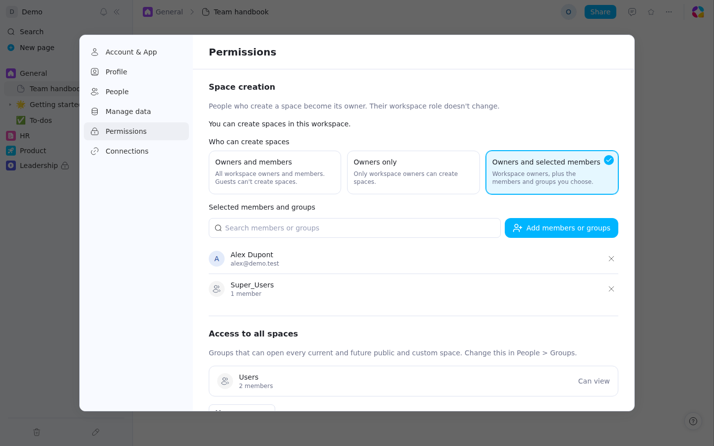

**Add members or groups lists who can be chosen.** Pressed with nothing typed: Sam and the HR,
Product and Users groups are listed under "Not selected"; Alex and Super_Users (already selected),
guests, owners and pending invitations are not. The spec checked Sam and HR are offered, Alex and
Super_Users are not, and that Escape closes the list. Nothing was added.

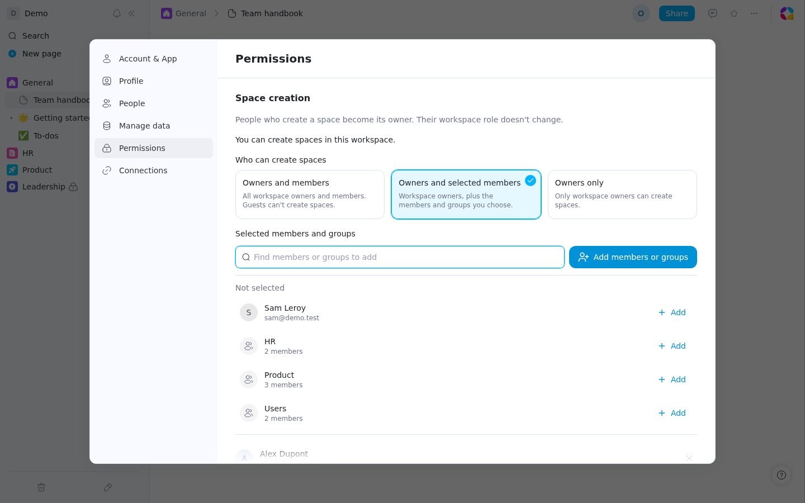

**Narrowing who can create spaces asks first.** Choosing "Owners only" opened this question. It
states the new rule, that the selected members and groups are kept for a switch back, and the
button names the rule ("Use Owners only"). It was cancelled and the spec checked that the policy
stayed "Owners and selected members". *Does not prove* what saving would do.

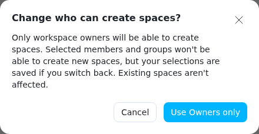

**Access to all spaces summary**, at the end of the panel (no fade). Groups with access to every
current and future public and custom space, and that private spaces and restricted pages are not
included; Users has Can view; the Manage groups button opens People > Groups. *Read-only*: it does
not show that the coverage applies to a given space.

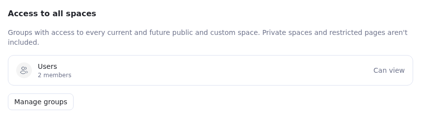

**Permissions, as a member.** Sam sees "You can't create spaces in this workspace." in a callout,
the current policy with every card unavailable (in the same order as for the owner), and "Only
workspace owners can change this." The
spec checked that the "Owners only" card is disabled. *Does not prove* that the server refuses
Sam's request to create a space (that is covered by server tests, not this run).

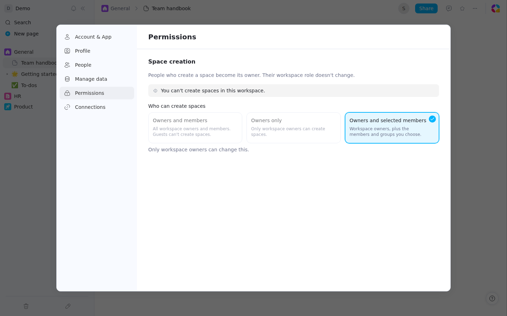

**People > Groups > HR > General, with the Access to all spaces menu open.** Off is ticked; Can view
and Can edit are offered. The menu covers the end of the description while it is open. *Does not
prove* a saved change.

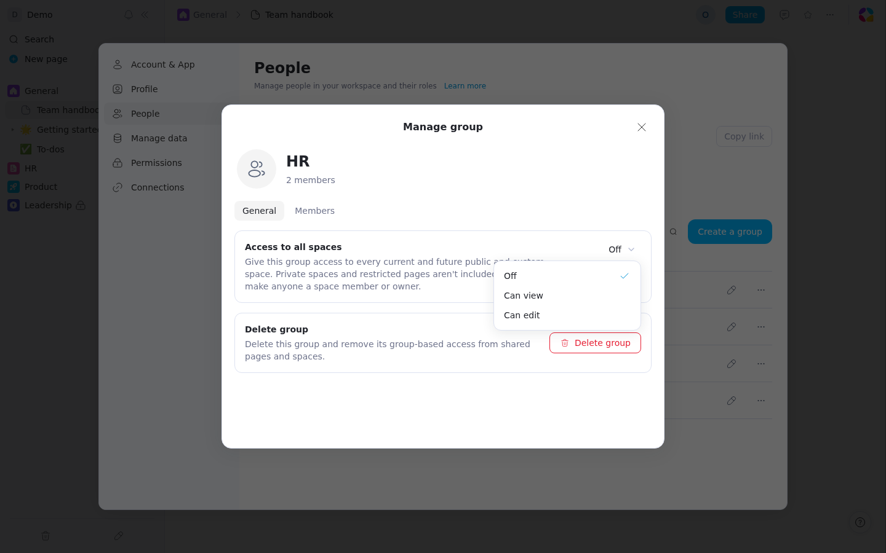

**Granting access to all spaces asks first.** Choosing Can edit for HR opened this question; it was
cancelled and the spec checked that the group stayed Off.

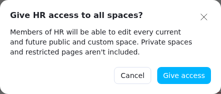

**Manage space · HR > General, as it opens.** The title names the space. The dialog takes the
window's height, so the whole tab fits at 1440×900: space members Can edit, everyone else in Demo
No access, and "Who can add pages to this space: Only space owners" with its explanation. The spec
checked the page setting is fully in view without scrolling and that no "more below" fade shows.
*Does not prove* that adding a page is refused for members (server and component tests cover
that).

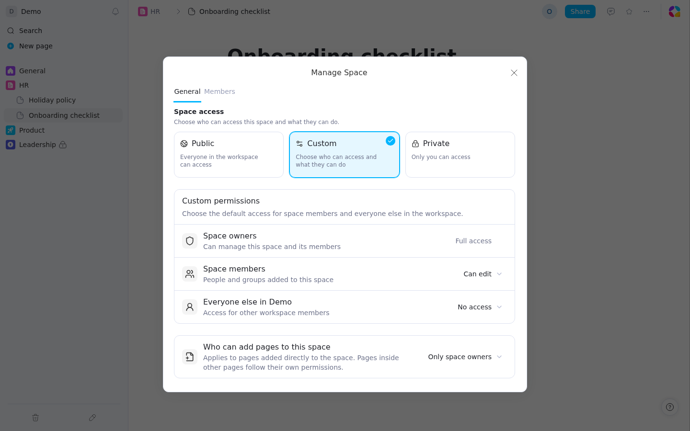

**Changing the space type asks first, in sentence case.** Choosing Public in HR opened "Make this
space public?"; it was cancelled and the spec checked that HR stayed Custom (also read back from
the server).

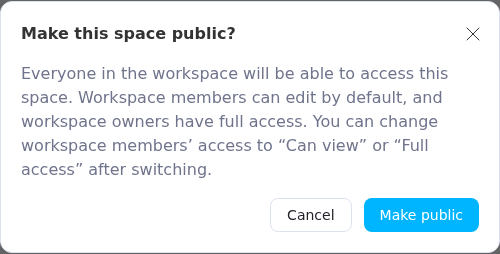

**Manage space · HR > Members, with one Access menu open.** Columns Name | Access | Role; the
headers end where the menus below them end. Olivia (space owner) has "Full access" as text; Alex
keeps the space default ("Can edit · default", ticked in the open menu with Can view, Can comment
and Can edit offered). The open menu covers the HR and Users levels; they show in the next image.
*Does not prove* that choosing a level saves.

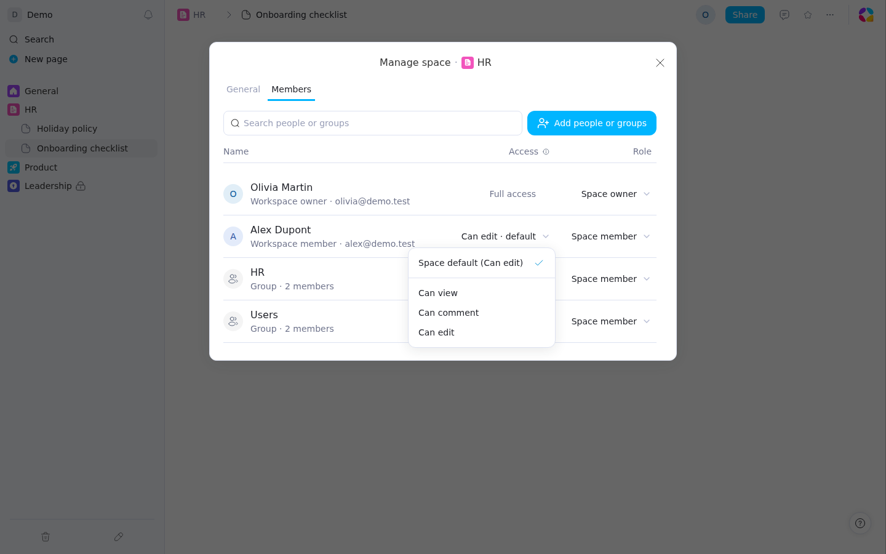

**The one explanation of per-person access** is the Access column header's tooltip: "Choose what
each person or group can do in this space, or keep the space default. ..." Here the HR group's Can
edit and the Users group's Can view are visible.

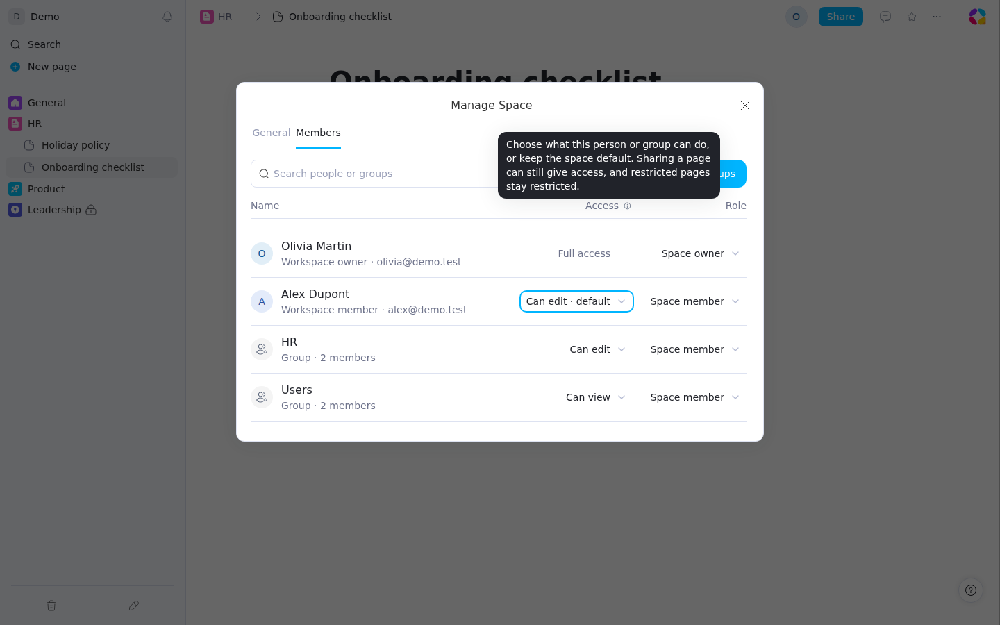

**Add people or groups lists who can be added.** Pressed with nothing typed: Sam (who reaches HR
only through the HR group) under "Not in space", and Product and Super_Users under "Groups not in
space"; the members list stays below. The spec checked all three are listed and that Escape closes
the list. Nothing was added.

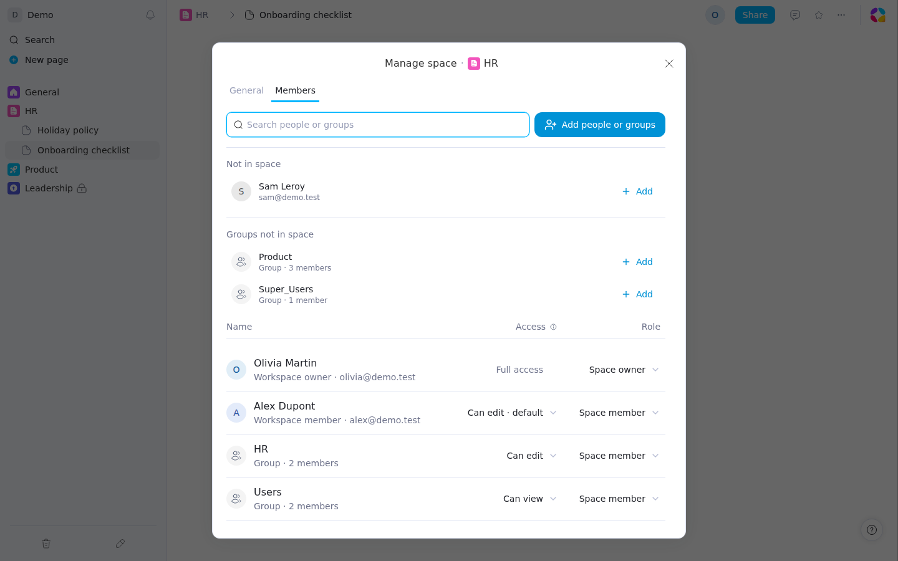

**Where your own extra access comes from, with the menu closed.** In Product, Olivia manages the
space as the workspace owner, but her own row is an ordinary member with Can view. An info icon
beside her closed menu says "You can also edit this space through the Product group." The spec
checked the icon's label and the tooltip.

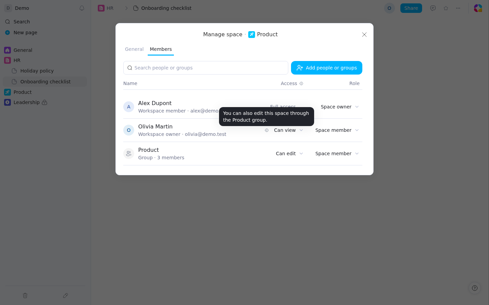

**The same note in the open menu.** Her menu ends with the same line. The spec checked that the
note names the Product group; the server reported Olivia's access as Can edit from a group
(`workspace_group`).

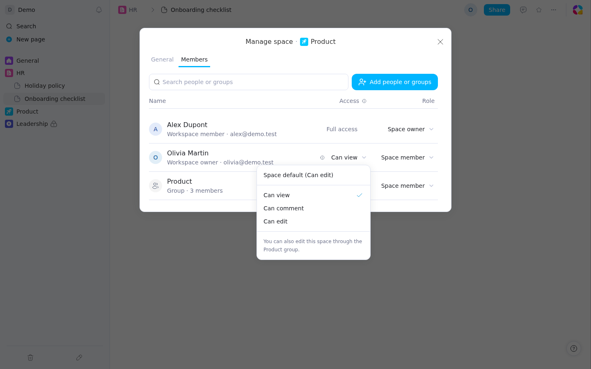

**Create space, as it opens** from New page, with a name typed; Public is the default type. A
Public space's settings are taller than the dialog at 1440×900, so a fade over "Who can add pages
to this space" says there is more below (the spec checked the fade is shown). Cancel and Create end
where the cards end. No space was created.

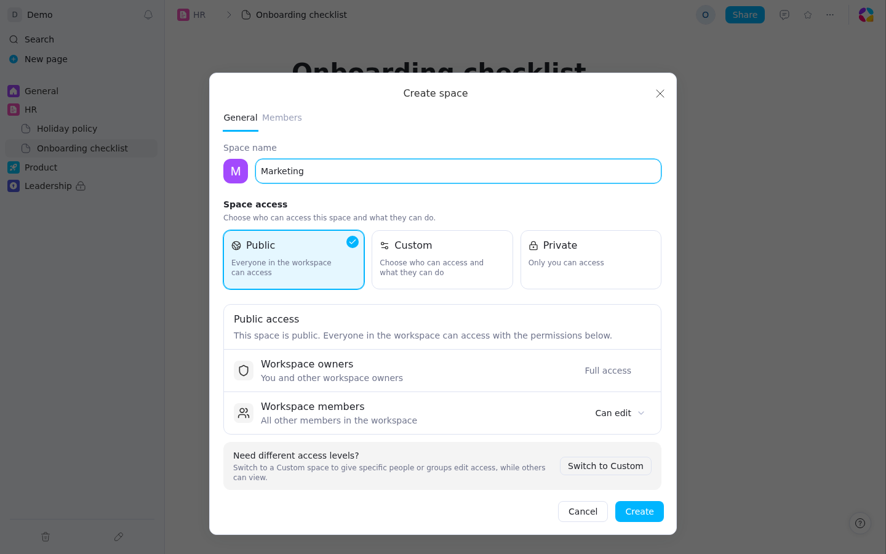

**Create space, scrolled to the end:** "Who can add pages to this space" in full and no fade (both
checked by the spec).

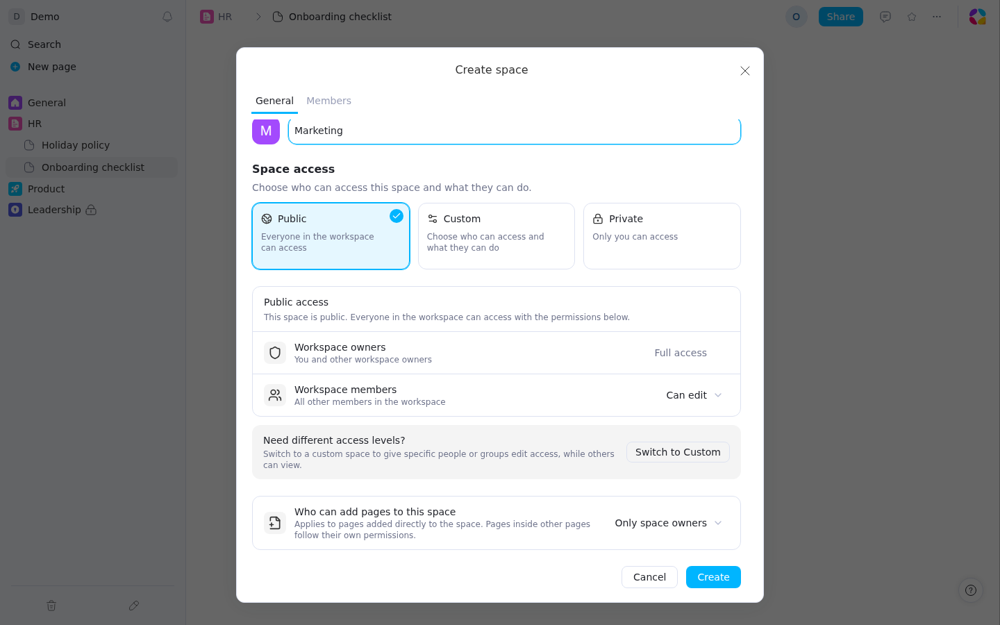

**Create space refused after the rule changed.** Alex, a selected space creator, opened Create space
from New page and typed "Marketing"; meanwhile the owner narrowed "Who can create spaces" to Owners
only through the API. The capture relays Alex's live connection and held back what the server pushed
from then on, as when the hint about a change arrives late, so the dialog still offered Create.
Pressing it rechecks with the server first, which refused: the form gave way to a summary of the
request (icon, name, type) and the answer "You can't create spaces in this workspace." with "Ask a
workspace owner if you need a new space." and Close as the only action. Nothing is kept: closing
releases the draft. The spec checked that Create was enabled before the change, that the server then
said Alex could not create, the message, the summary, that the name field and Create button were
gone, that Close had keyboard focus (pressed with the mouse here, so no focus ring shows), that Close
hid the dialog and that no Marketing space existed afterwards; the rule was put back
and read back (Alex can create again). *Does not prove* what happens when the hint arrives in time:
the dialog then disables Create with the same message instead (component tests cover both).

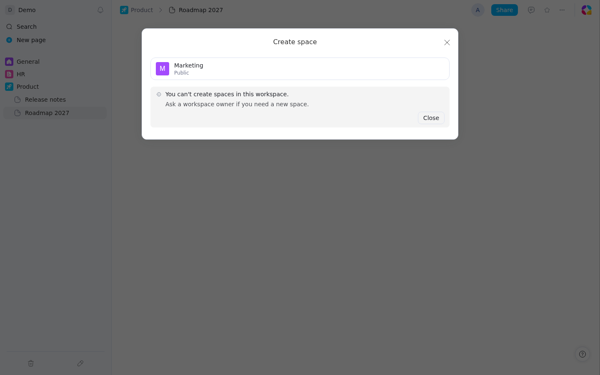

**Workspace menu without permission to create workspaces.** Alex is not selected by the operator:
Create workspace and Import workspace are unavailable; under the pointer the entry has no fill and a
not-allowed cursor, and the tooltip "Your administrator hasn't allowed you to create workspaces."
opens clear of the menu. The spec checked that the item is marked unavailable and the tooltip is
shown. *Does not prove* that the server refuses a creation request.

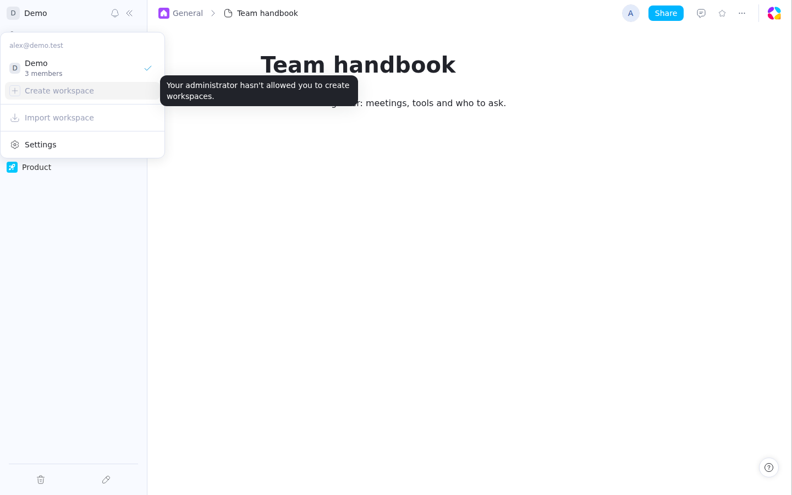

**Signed in without a workspace.** Jordan sees "You're not in a workspace yet", the signed-in
address, "Join a workspace you've been invited to below.", the pending invitation to Demo with Join
and, under "Invited by Olivia Martin", "Invited as a guest", the reason creation is unavailable,
Check again as a text button, and Sign out. Retaken in the third rerun, against a server that sends
the invited role. The spec checked the join line is shown and the "ask a workspace owner" line is
not, that the invitation it read back carries the role `"Guest"`, and that "Invited as a guest" is
shown; the API read back an empty workspace list and the pending guest invitation. *Not tested*:
joining, or what a guest can open after joining.

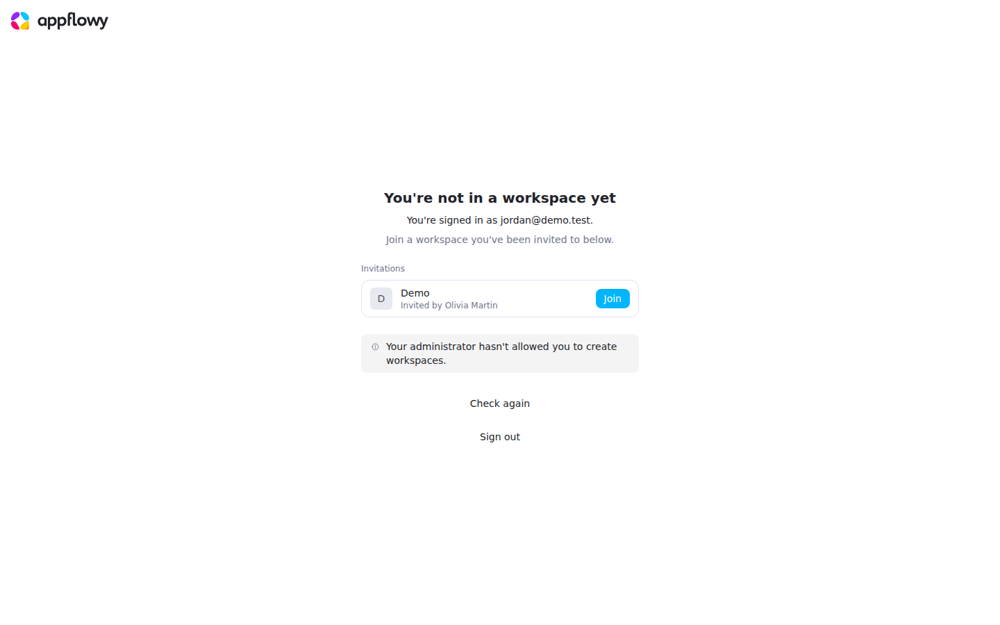

**An open page loses access when its group's access is removed.** Sam had "Onboarding checklist"
(HR) open; the owner removed the HR group from the HR space through the API. The page shows "No
access to this page" with balanced lines, HR left the sidebar, and the top bar offers no page
actions. The spec checked the server answer for Sam (`can_read: false`), the message, that the
editor was gone and that there is no Share button.

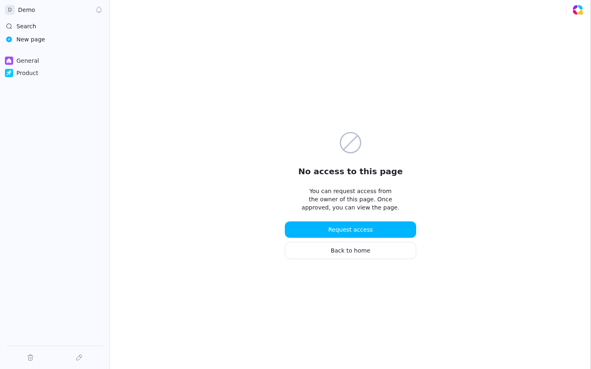

**The same page recovers without a reload when access is given back.** The owner restored the HR
group's Can edit through the API. The spec checked `can_write: true`, the page text, that Share is
back, and that the tab was not reloaded (a marker set in the page survived). *Does not prove* that
typing is saved (no edit was made).

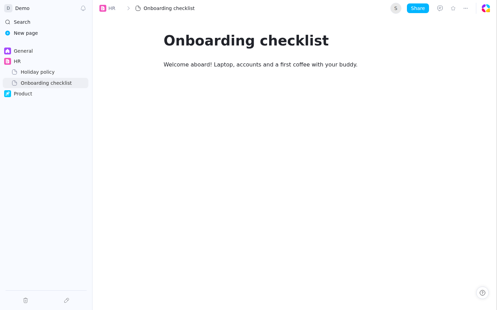

**Sign out question** (Settings > Account & App > Sign out) with "Also remove page copies from this
browser" and where unsent changes stay. Behind it, Account & App shows "Set up password" and the
"Sign out" row. Nobody signed out; *does not prove* what is removed.

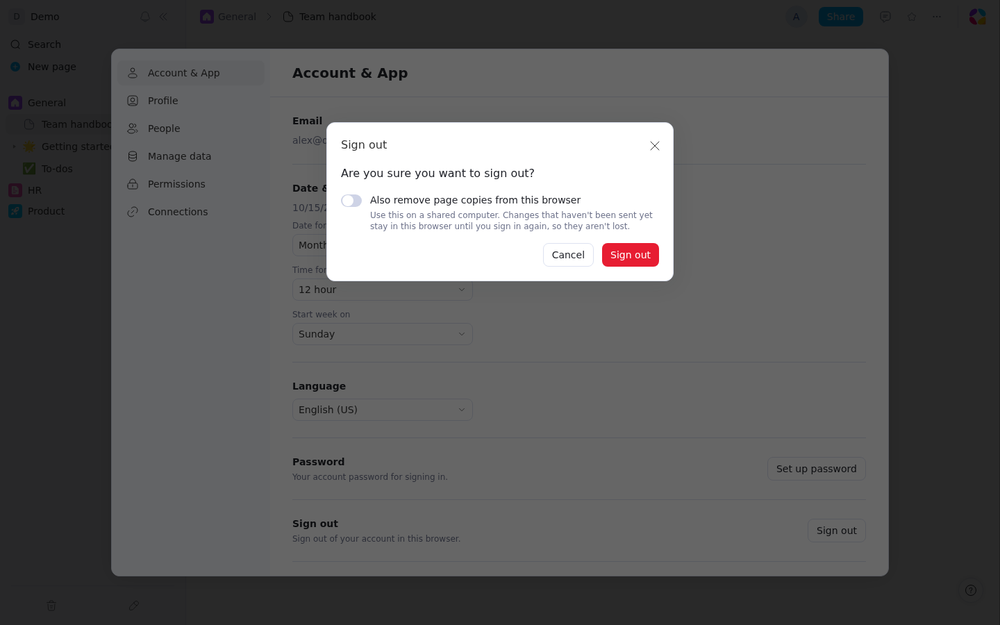

## Follow-up fixes after the Desktop design review (captured in the rerun)

Made test-first on `oodrive-fix/web-final` so Web says and does the same as Desktop:

- `d7327d21` The space creation choices read from the most to the fewest people: Owners and members,
  Owners and selected members, Owners only (narrowing still asks first).
- `a8a269d1` The account-only page adds "Invited as a guest" under an invitation the server marks
  as a guest invitation (captured in the third rerun). What the page reads is `role` on each item of
  `GET /api/workspace/invite?status=Pending`, the invitation's role by name (`"Owner"`, `"Member"` or
  `"Guest"`, spelt as a workspace member's `role` already is); no field, or any other value, adds
  nothing, so a server that sends no role shows no line.
- `9aaec729` Failure toasts in Manage space and People > Groups name the change that failed and give
  a plain reason ("Couldn't change access for Alex. You don't have permission to do this."), with the
  confirmed value kept on screen (not captured; component tests cover them).
- `fde232d7` When the rule refuses a new space on Create, the form gives way to a summary of the
  request and the answer, with Close as the only action, and the draft is released (captured above).

## Review follow-ups (second rerun)

Made test-first on `oodrive-fix/web-final` after an independent review of the fixes above; the two
captures they could touch were run again and came out byte for byte the same:

- `514c4acc` The French toast for a failed change to a group's access to all spaces says whose access
  could not be changed ("l’accès de {{group}} à tous les espaces"); not visible in this English gallery.
- `3b516537` When the rule refuses a new space on Create, Close takes keyboard focus as the card
  appears, so a keyboard or screen reader user does not lose their place; the spec now asserts it
  (no focus ring in the capture, as Create was pressed with the mouse).
- `84b75699` This record named the exact field the "Invited as a guest" line reads, and the spec
  checked the line whenever the server sent the role (none did until the third rerun).
- `967a6c36`, `8d29f0e3` This README and the manifest name the commit that holds the first rerun's
  harness and say that a rerun can differ by a few pixels.

## Guest invitation line (third rerun, 2026-10-15)

The integration branch's invitation list now sends the invited role (server `e2a01e66c`), so the
account-only page was retaken; nothing else was run again.

- The capture spec's account-only test now requires the role `"Guest"` on the invitation it reads
  back and that "Invited as a guest" is shown; a run without the role is no longer noted as waiting
  for the server. The seed already invited Jordan as a guest (and Alex and Sam as members), so it did
  not change.
- Only that image changed: the guest line under "Invited by Olivia Martin"; the taller row moves the
  centred content up 8 px.
- Read back after the run: Jordan's pending invitation to Demo has the role `"Guest"`, Jordan has no
  workspace and may not create one, only selected users may create workspaces, and Demo's members
  are Olivia (Owner), Alex and Sam (Members) and Jordan (pending Guest).

## UI fixes made while refreshing the gallery

Found in these captures or in the design review of the first refresh, and fixed test-first before
the final run (Web commits on `oodrive-fix/web-visual`):

- `f8c5d0a5` Space settings dialogs take the window's height (the tabs were capped at 64% of it), a
  fade shows while more settings are below (also in settings panels), and the footer buttons end
  where the cards end.
- `6927372b` General and Members tabs use the app's tab labels; section headings are larger than
  card and row titles; the Access and Role headers end where their menus end.
- `ce0489b9` "Manage space" in sentence case, with the space's icon and name in the title.
- `efc3a04c` The space type and full access questions are in sentence case.
- `93bbbf20` The Access header tooltip explains the column ("each person or group").
- `7b35e163` An info icon beside your own closed Access menu says where more access comes from.
- `0ae79bbd` The narrowing question states the new rule and that selections are kept ("Use Owners
  only"); the Access to all spaces summary no longer says "open" or points at People > Groups.
- `c9ec5e8b` A member who can't create spaces sees the answer in a callout.
- `e38a7759` Add members or groups (Permissions), Add people or groups (Manage space) and Add members
  (Create space) list who can be added before anything is typed.
- `50691060` The account-only page asks to join a waiting invitation and makes Join the main action.
- `3040909d` The sign-out option says it removes page copies and where unsent changes stay; "Sign
  out" everywhere; "Set up password".
- `02c1976c`, `7af339a6` The reason for an unavailable menu entry opens clear of the menu; the entry
  has no fill under the pointer and keeps the fill for keyboard focus.
- `da77b101` No page actions on a page you can't open; its message has balanced lines.

From the first refresh:

- `e7862526` Manage space's member table: in a wide fallback font the Role menu read "Space mem…" and
  emails were cut ("olivia@de…"). The dialog is now 760px wide and the Role column fits "Space
  member". Groups use the group icon shown everywhere else instead of a letter avatar.
- `005eff66` Sign-out question: the hidden dialog footer left an empty gap under the buttons, and the
  question used "logout" as a verb.
- `564d200b` Public space card: "Everyone in the Workspace can access" is now in sentence case (the
  French text no longer claims full access).

## Historical captures (still match the current UI)

These were captured on 2026-10-12, before the redesign, against an earlier server build. The page,
"No access to this page" and search views they show were not changed by the redesign (compare
the current captures above and a 2026-10-14 look at the search dialog), so they are kept. They were
not re-run for this refresh. One exception in detail: since `da77b101` the "No access to this page"
view has no page actions in its top bar and balances its message, so `grant-removed-primary.png`
and `grant-removed-follower.png` still show the older top bar and line breaks (the current view is
in *An open page loses access when its group's access is removed* above); they are kept for what
the lifecycle run proved.

**Document lifecycle run `cc3e83eb-a782-45bb-b834-3b6c1cf16f7f` (passed, 44 checks).** Three
documents of a separate fixture; owner API calls changed a group grant and a group membership; a
second tab followed the same change; a delayed allowed answer for the revoked document was
delivered and did not bring the content back. Its server build predates the final server review
fixes. Titles are generated fixture names.

| Image | What it showed |
| --- | --- |
| [initial-view-primary.png](initial-view-primary.png) | The primary document with View access (the DOM checks, not the image, established read-only). |
| [explicit-edit-primary-title-focused.png](explicit-edit-primary-title-focused.png) | The same open page after Edit was granted, with its title focused and editable. |
| [grant-removed-primary.png](grant-removed-primary.png) | The primary document denied after its group grant was removed; Shared with me keeps two independently granted documents. |
| [grant-removed-direct.png](grant-removed-direct.png) | A document shared directly stays visible and editable after the same removal. |
| [grant-removed-second.png](grant-removed-second.png) | A document granted through a second group stays editable. |
| [grant-removed-follower.png](grant-removed-follower.png) | A second open tab of the primary document also shows the denial without reloading (same pixels as the primary tab). |
| [final-recovered-view-primary.png](final-recovered-view-primary.png) | The primary document back to View on its original route after the regrant. |

**Search reader runs `e589fbf2-943d-458c-aa13-377b2934b129` and
`8b91758c-b947-4751-9a36-78419e967464` (passed).** Keyword search and recent pages before and after
revocation and regrant, including a held allowed answer delivered after revocation. AI requests were
blocked, so the visible Ask AI entry carries no AI claim. The gallery stack has no search service,
so these were not repeated.

| Image | What it showed |
| --- | --- |
| [historical-body-search-allowed.png](historical-body-search-allowed.png) | A protected body snippet found by keyword search before revocation. |
| [historical-body-search-revoked.png](historical-body-search-revoked.png) | The snippet gone after revocation while a fresh search is pending. |
| [historical-body-search-late-denied.png](historical-body-search-late-denied.png) | No results after an old allowed answer was delivered after revocation. |
| [historical-body-search-regranted.png](historical-body-search-regranted.png) | The snippet back after regrant. |
| [historical-recent-positive.png](historical-recent-positive.png) | The protected page in Recent pages before revocation. |
| [historical-recent-revoked.png](historical-recent-revoked.png) | Recent pages without it after revocation. |
| [historical-recent-late-response-hidden.png](historical-recent-late-response-hidden.png) | Still hidden after an old recent-pages answer was delivered (same pixels as the revoked state). |
| [historical-recent-regranted.png](historical-recent-regranted.png) | Back after regrant. |

## Removed captures of the old UI

Native selects, radio buttons, Save buttons and internal wording that the redesign replaced:
`review-current-creator-controls.png`, `owner-space-creator-settings.png` and
`owner-space-creator-group-settings.png` (now *Permissions, as the owner*);
`review-coverage-off.png`, `review-coverage-view-draft.png`, `review-coverage-edit-draft.png` and
`owner-group-coverage-settings.png` (now the summary, the group dialog menu and its confirmation);
`owner-group-view-assignment.png` (now *Manage space > Members*); `historical-sidebar-policy.png`
(now *Manage space > General*); `review-account-only.png` and `historical-account-only.png` (now
*Signed in without a workspace*). They remain in the Git history.

## Feature-to-evidence map

| Feature | Current captures | Automated coverage |
| --- | --- | --- |
| A — per-person access in Custom spaces | Manage space members, Access explanation, add list, own access icon and menu | [Manage Space](../../../../src/components/app/view-actions/__tests__/ManageSpace.test.tsx), [access menu](../../../../src/components/app/view-actions/__tests__/SpaceMemberAccessControl.menu.test.tsx), [copy](../../../../src/components/app/view-actions/__tests__/spaceAccessCopy.test.ts) |
| B — who can create spaces | Permissions as owner and as member, add list, narrowing confirmation, Create space, Create space refused | [Permissions panel](../../../../src/components/app/settings/__tests__/WorkspacePermissionsPanel.test.tsx), [copy](../../../../src/components/app/settings/__tests__/WorkspacePermissions.i18n.test.ts), [creation capability](../../../../src/components/app/hooks/__tests__/useSpaceCreationCapability.test.tsx), [Create space](../../../../src/components/app/view-actions/__tests__/CreateSpaceModal.test.tsx) |
| C — access to all spaces | Summary, group dialog menu, grant confirmation | [Group coverage](../../../../src/components/app/settings/__tests__/GroupSpaceCoverageControl.test.tsx), [its menu](../../../../src/components/app/settings/__tests__/GroupSpaceCoverageCard.menu.test.tsx) |
| P — who can add pages | Manage space > General, Create space scrolled | [Action gates](../../../../src/components/app/view-actions/__tests__/actionPermissionGates.test.tsx), [dialog layout](../../../../src/components/app/view-actions/__tests__/SpaceSettingsPanel.layout.test.tsx) |
| Space type questions | Make this space public? | [copy](../../../../src/components/app/view-actions/__tests__/spaceAccessCopy.test.ts) |
| D — workspace creation limits | Workspace menu, account-only page | [NoWorkspace](../../../../src/components/app/workspaces/__tests__/NoWorkspace.test.tsx) (also the guest invitation line), [invitation list](../../../../src/application/services/js-services/http/__tests__/workspace-invitations-api.test.ts), [unavailable entry](../../../../src/components/app/workspaces/__tests__/UnavailableMenuItem.test.tsx), [Workspaces menu](../../../../src/components/app/workspaces/__tests__/Workspaces.creation.test.tsx) |
| R — live permission refresh | Open page loses and regains access | Historical 44-check lifecycle ([spec](../../../e2e/app/space-group-permission-lifecycle.spec.ts)), [page actions](../../../../src/components/app/header/__tests__/RightMenu.rowFavorite.test.tsx) |
| Sign out | Sign out question | [LogoutConfirm](../../../../src/components/app/workspaces/__tests__/LogoutConfirm.test.tsx) |

## Limits

- One browser (Chromium, headless: scrollbars are hidden), one viewport, English only. No Desktop
  client, no login screen, no mobile layout.
- Running the capture spec again on the same source gives the same screens, but not always the same
  bytes: a few pixels can differ where the pointer happens to rest or in the anti-aliasing of text
  and icons. A hash that differs from the manifest therefore means a fresh capture, not a hand edit
  (no image here was edited by hand); compare the images to judge a change.
- Synthetic data on a self-hosted build; the Worker, search and AI services were not running.
- The gallery run changed permissions only through owner and operator API calls; it does not show
  that saving from these controls works (component tests and server tests cover that separately).
- The account-only page was retaken against a later server build (`e2a01e66c`) than the other
  current captures, because only that build sends the invited role; no other screen here shows it.
- Failure toasts, which now name the change that failed and give a plain reason, are not captured;
  component tests cover them.
- [validation.json](validation.json) records the 2026-10-12 validation of the earlier draft. The
  checks for this refresh are listed in the manifest's `current_capture` section.
- Reproducing the historical lifecycle run needs its private fixture; see
  [the compatibility guide](../../../../doc/web-server-compatibility.md).
