# Workspace permissions: Web review evidence

Group permission changes must update open pages and navigation without a reload. The Web client
rechecks canonical capabilities on real workspace revisions, removes denied content, disables editing
for View access, and retains independent direct or second-group grants. The management controls keep
explicit user/group levels distinct from inherited defaults; creation, sidebar and coverage settings
have separate authority.

**The connected document lifecycle passed: 44 checks, with restoration and preservation passing.**
Run `cc3e83eb-a782-45bb-b834-3b6c1cf16f7f` completed in 1.1 minutes. Its eleven screenshots below are
unaltered captures from that run. The expanded packet includes five fresh read-only captures and ten
separately labelled historical captures: **26 captures total**. The packet
does not claim every feature, persona or client has passed. Visible accounts and content are synthetic;
no credentials, private configuration or live tokens are included. Capture and qualification hashes
are recorded in [capture-manifest.json](capture-manifest.json).

The live server used for the retained lifecycle and fresh settings captures predates the final four
Rust review fixes. Those fixes have separate server component validation; this gallery does not claim
a full connected run against the newest server source.

## Fresh review captures

These five screenshots were captured on 2026-10-12 from the real Web app and existing synthetic
accounts. They use current Web source; all browser HTTP mutations were blocked, including profile,
workspace-open and recent-page updates. Coverage GETs remained Off before, during and after both
local drafts. No permission setting, membership or content was changed. API sign-in and unchanged
WebSocket forwarding were used; this is not login-UI or policy-mutation acceptance.

**Creator policy and retained selections.** This fixture currently allows Members and Owners. The
inactive Member selection remains visible for reuse when the selected-members mode is enabled.

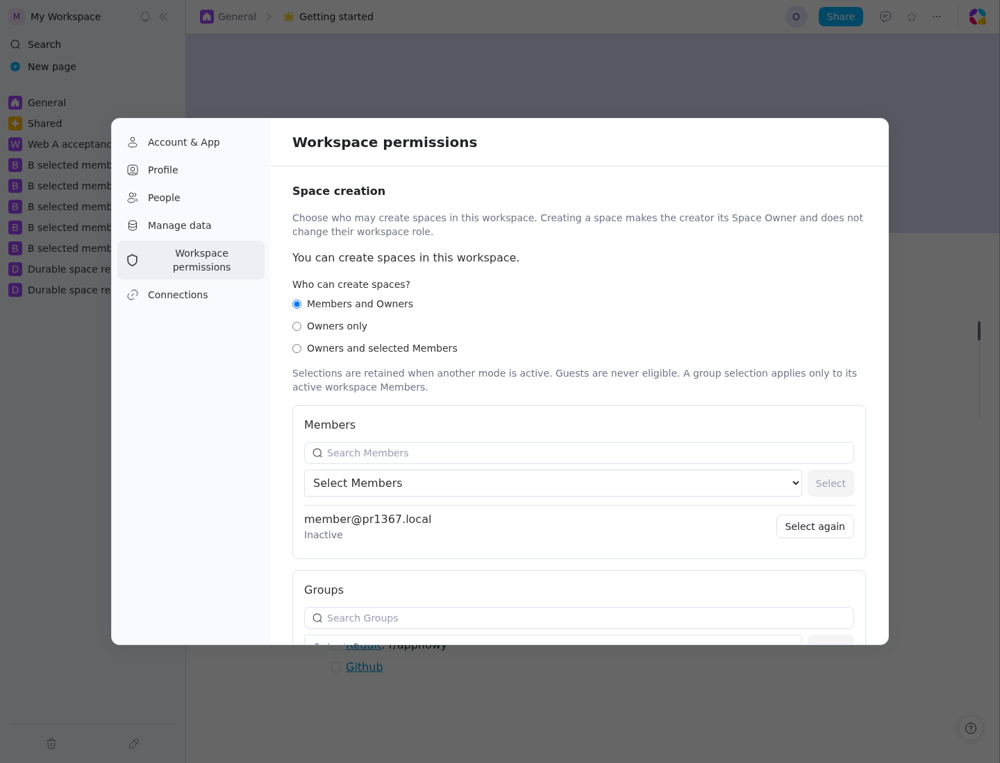

**Optional coverage remains Off until saved.** The scope explanation distinguishes current/future
Public and Custom spaces, excludes Private spaces, and preserves page restrictions.

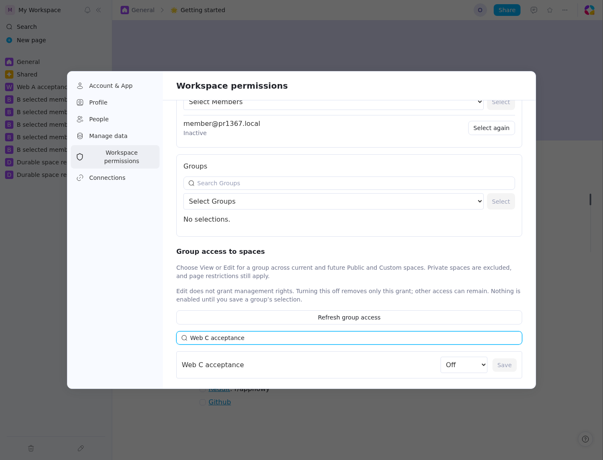

**View draft.** Selecting Can view enables Save; the server still reports Off.

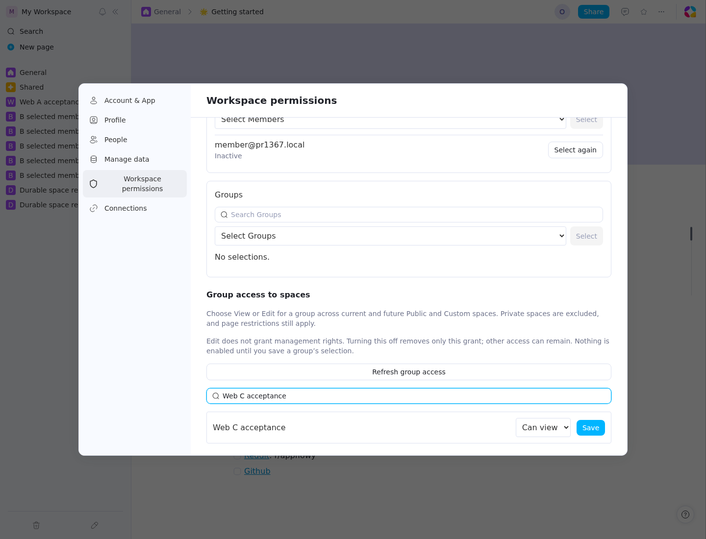

**Edit draft.** Selecting Can edit also remains a local draft until Save. The test resets it to Off
and verifies Save becomes disabled again. These images do not show a saved grant.

**Account-only state.** An existing signed-in account has no workspace and cannot create or import
one. Invitation guidance remains visible. The API confirms an empty workspace list and null visiting
workspace; this image alone does not establish automatic-home suppression.

## Feature-to-evidence map

| Feature | Behavior being reviewed | Evidence and scope |
| --- | --- | --- |
| A — user and group levels | Member assignments distinguish inherited `null`, View and Edit; independent readable grants survive removal of another grant. | Passed document lifecycle and owner-assignment captures below; [Manage Space component cases](../../../../src/components/app/view-actions/__tests__/ManageSpace.test.tsx) and [tri-state BDD scenarios](../../features/workspace/space-group-permission-resolution.feature). BDD generation passed; the older BDD fixture was not executed by this run. |
| B — selected space creators | Creation controls use the selected-user/group capability; creation permission does not grant document Write. | Read-only current policy and Member/Group controls below; [Workspace permission controls](../../../../src/components/app/settings/__tests__/WorkspacePermissionsPanel.test.tsx) and [creation capability cases](../../../../src/components/app/hooks/__tests__/useSpaceCreationCapability.test.tsx). This lifecycle did not mutate creator selections or create a space. |
| P — sidebar rules | Direct space-child actions also require sidebar authority; nested pages retain their own Write check. | Historical [sidebar policy UI](historical-sidebar-policy.png) below; [action gate cases](../../../../src/components/app/view-actions/__tests__/actionPermissionGates.test.tsx). This screenshot shows configuration, not a fresh mutation run. |
| C — optional group coverage | Coverage is inactive until configured; Public/Custom View/Edit coverage excludes Private spaces and preserves page restrictions. | Read-only scope and owned-group Off capture below; [Group coverage settings cases](../../../../src/components/app/settings/__tests__/GroupSpaceAccessSettings.test.tsx) and the separately retained server coverage matrix. No coverage mutation was performed by this lifecycle. |
| D — workspace creation restrictions | A signed-in account with no workspace can see invitation guidance while creation/import are unavailable. | Historical [account-only state](historical-account-only.png) below and [NoWorkspace cases](../../../../src/components/app/workspaces/__tests__/NoWorkspace.test.tsx). The screenshot does not prove automatic-home suppression by itself. |
| R — live permission refresh | Open editor state follows group grant and membership changes; delayed old responses must not restore revoked content. | Passed [connected document suite](../../../e2e/app/space-group-permission-lifecycle.spec.ts): real revisions, follower tab and a genuinely delivered stale allowance. Historical body-search captures have a separate passed real-response-delay result and make no AI/provider claim. |

## Passed document lifecycle

The suite reuses three documents from the passed server fixture. The primary document inherits the
space group assignment. The controls have independent direct Edit and second-group Edit. A second
primary tab observes the same real revision through the app's cross-tab flow. Owner API calls drove
permission changes. The management screenshots were captured read-only after restoring View.

**View:** the primary body remains visible. DOM assertions verify that Slate is read-only and the
editable title control is absent; the screenshot alone cannot establish editability.

**Edit:** the same route and in-memory page remain open. The visible title caret accompanies assertions
that the title is focused/editable and the body is editable. Focus did not type or change content.

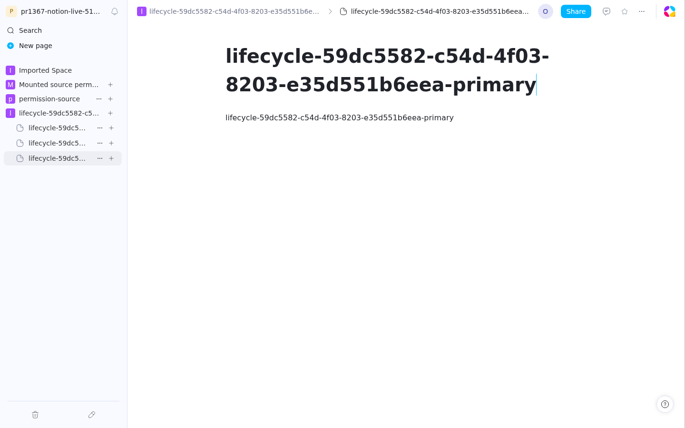

**Group grant removed:** primary content and edit controls disappear. Shared with me retains the two
independently granted documents. The test checks exact canonical capabilities and both navigation trees.

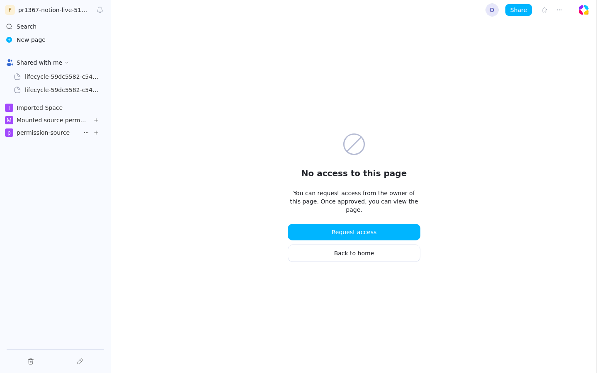

**Independent direct grant:** this document remains visible and editable after the same removal.
The sidebar now exposes it through Shared with me; DOM assertions verify its body and title controls.

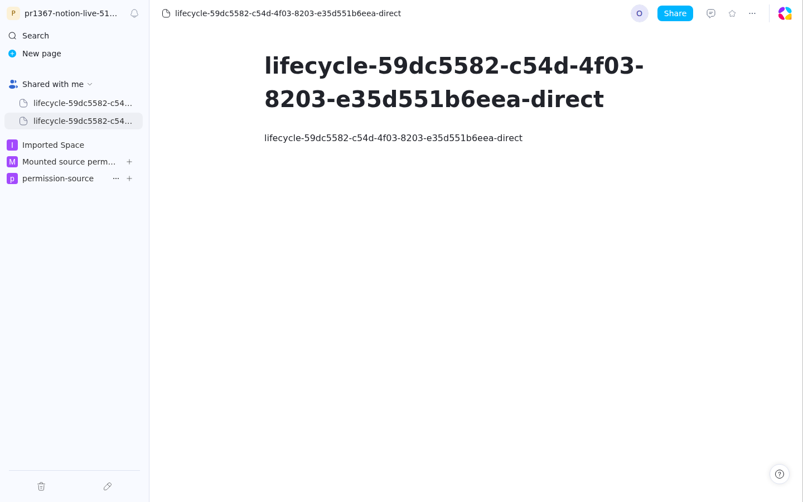

**Independent second-group grant:** the other control document also retains Edit access.

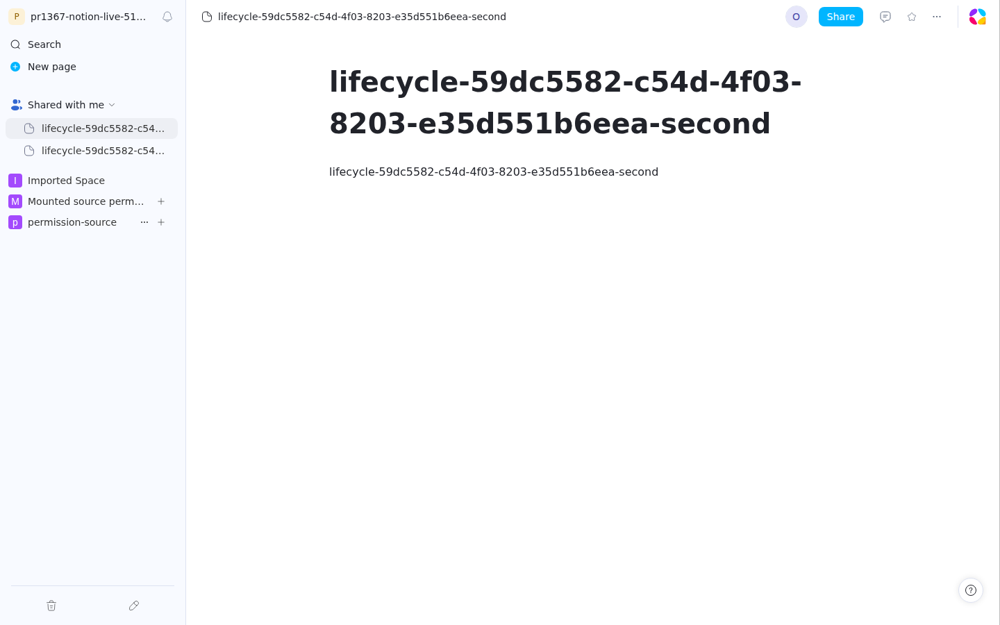

**Follower tab:** the second already-open primary tab receives the real revision and shows denial
without reloading. Its route and in-memory marker are checked, not inferred from this image.

**Regranted View:** the primary document recovers on its original route and in-memory page. The suite
also checks Edit-to-View, group membership removal/re-addition, and the independently granted controls
at each phase. The stale-response observer is disconnected before this intentional regrant.

**Explicit group assignment:** the owner opens Manage Space without changing it. The group remains a
Space member with explicit Can view, while the space default is No access. The synthetic account names
do not determine their roles; the displayed Owner/Member roles are the canonical assignments.

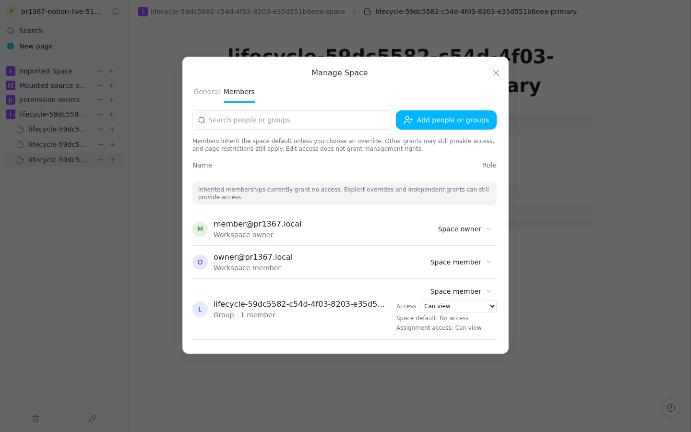

**B, current creator policy:** the existing policy is Owners and selected Members. The existing Member
entry is inactive and offers Select again; this read-only image does not claim that it grants creation.

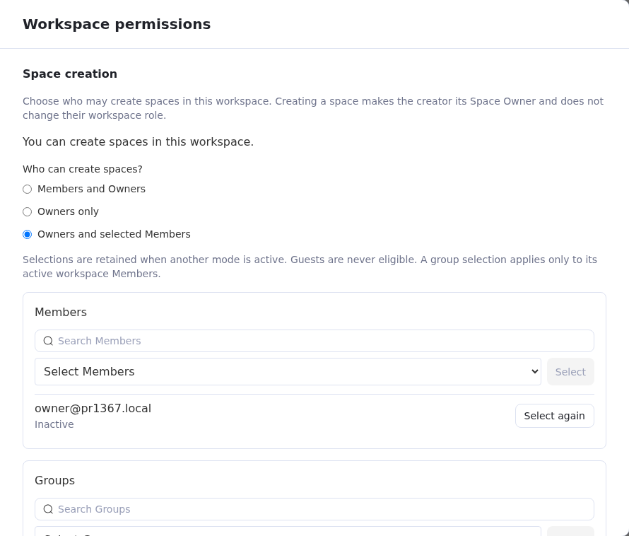

**B, group controls:** a separate capture after scrolling shows the complete Group selection controls
and current No selections state. No selection was added or removed.

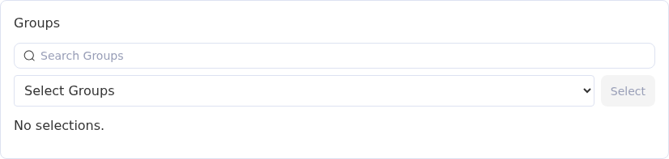

**C, existing coverage Off:** the owner filters to the synthetic primary group. Scope text includes
current/future Public and Custom spaces, excludes Private spaces and preserves page restrictions.
The selector remains Off and Save is disabled; no coverage change was made.

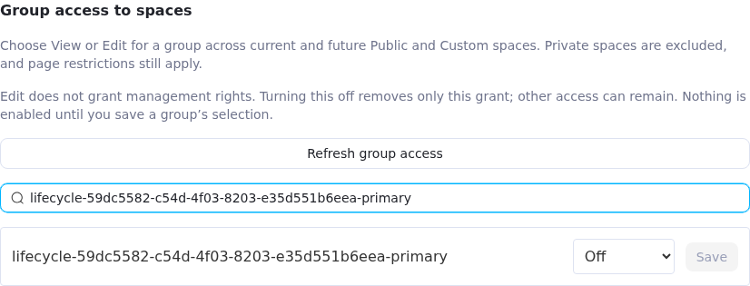

The late-response case held a real canonical Edit response, revoked access with a newer server
revision, and then fulfilled that exact response. The matching browser request finished successfully
without cancellation. Content and controls stayed absent throughout the observed delivery interval.
This establishes delivered-response rejection, rather than relying only on request cancellation.

The sidebar oracle combines the fresh workspace tree and the separate Shared with me tree, matching
the application's production composition. A workspace root response alone is not the whole sidebar.
This fixture covers documents and UI controls; it does not establish database/grid/row behavior or
CRDT edit acceptance. The server lifecycle separately exercised actual allowed/denied name writes.

## Historical screenshots

**P: direct-child sidebar policy.** Manage Space exposes “Space Owners only” independently of the
Custom Member content default. This is the existing synthetic configuration capture, not the new
space-group lifecycle fixture.

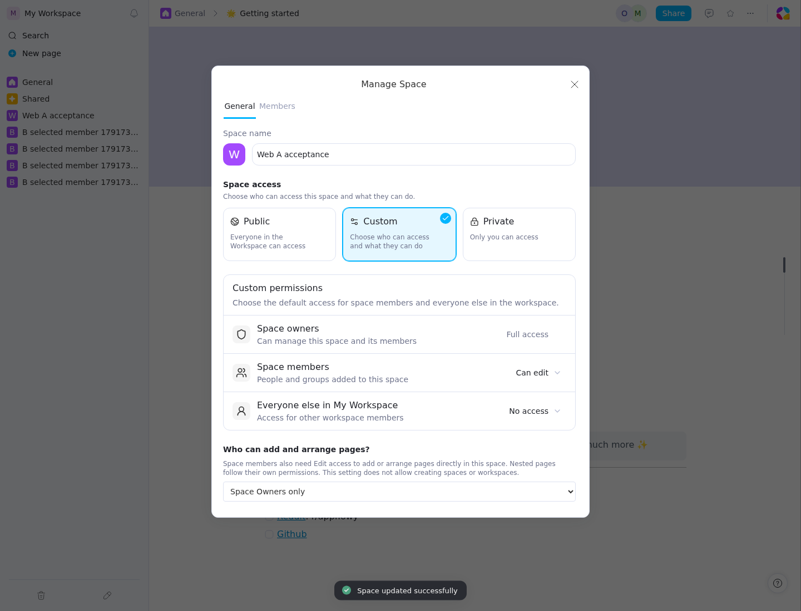

**D: signed in without a workspace.** The account remains signed in, receives invitation guidance,
and sees disabled Create workspace and Import workspace actions.

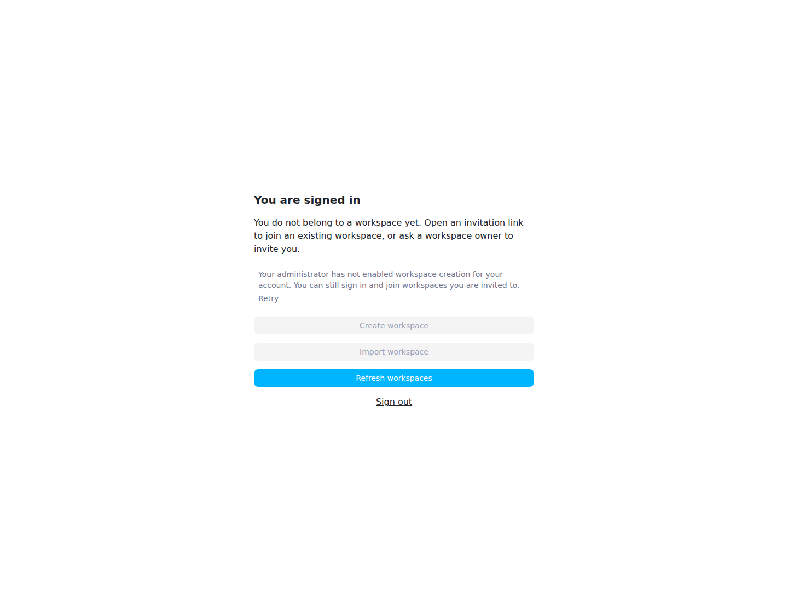

**R: body-search access before revocation.** A real editor-authored body snippet is visible in the
open keyword search dialog. The AI action is present in the UI but its requests were blocked during
this test, so this is a keyword-only claim.

**R: old body-search response delivered after revocation.** The same query shows no results after the
held real allowed response was fulfilled. This passed result is independent of the document
capability response test.

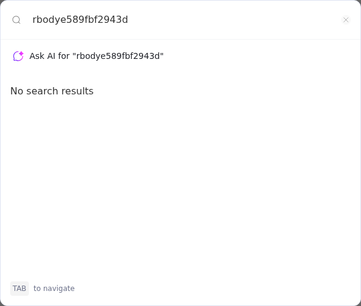

## Additional historical reader states

The following captures extend the original search examples with revocation and recovery. They remain
separate from the 44-check document lifecycle. Their passed run IDs and original result hashes are in
the capture manifest. AI routes were blocked, so the visible Ask AI action carries no AI acceptance claim.

**Body snippet disappears after revocation**, including while fresh search is pending.

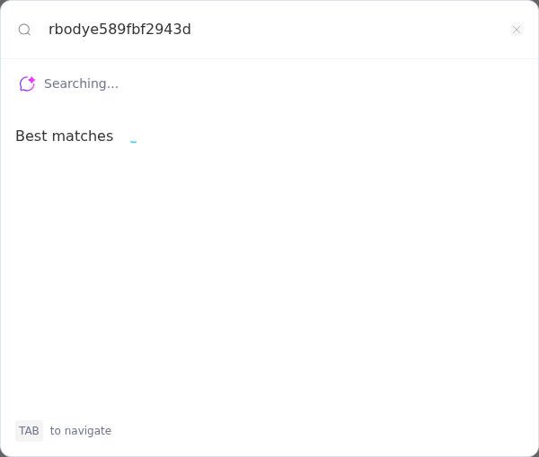

**The same query recovers after regrant**, including its editor-authored protected body snippet.

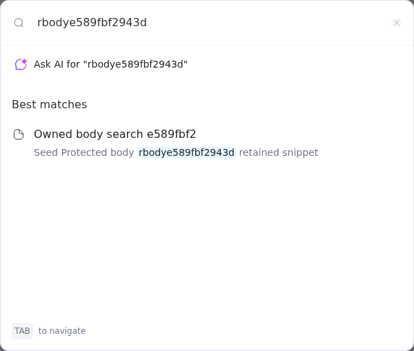

**Recent metadata before revocation.** The protected document name appears in the open search dialog.

**Recent metadata after revocation.** The old document name disappears.

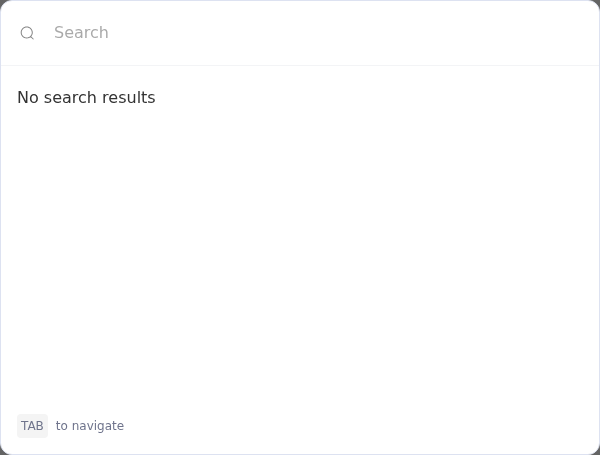

**Recent metadata after regrant.** The same document becomes available again.

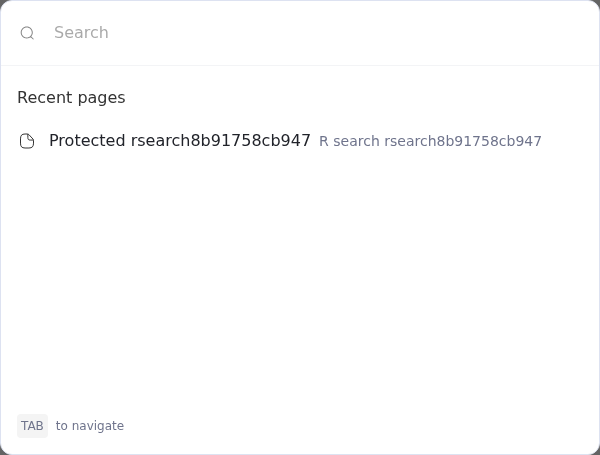

**An old recent response delivered after revocation does not restore the name.** This uses a held
real allowed response; it is distinct from simply cancelling an obsolete request.

## Reproduction and limits

Use [the compatibility guide](../../../../doc/web-server-compatibility.md) for the opt-in command and
private fixture inputs. The suite refuses unqualified processes, altered original server evidence,
or a fixture whose grants/memberships/content differ from the owned baseline. It records the actual
Web source manifest and verifies it remains unchanged through the run. A post-build
requalification only verifies identity and preserved state; it does not rerun the original 65 server
checks. Its reviewed SHA256 must be supplied explicitly. Failed attempts remain separate artifacts.

Validation repeated while preparing the draft PR passed:

- 1,021 Jest tests in all 70 modified/new suites.
- Real Chromium/IndexedDB retention and isolation harness: denial, reload, explicit retry,
  cross-tab denial, server/account/workspace changes, retained legacy bytes and sign-out.
- `pnpm lint` (full application ESLint and production TypeScript); permission-harness TypeScript; ten Python guards; four offline
  Playwright transport/identity cases; BDD generation and whitespace checks.
- Five new read-only UI captures with coverage readback and account-only assertions.

Earlier connected validation passed:

- One connected Playwright case, 44 checks; exact starting grant/membership restored, owned document
  bytes and all 392 original collab source records preserved, protected policy/member rows unchanged.
- Production type-check, scoped test TypeScript and scoped ESLint.
- Four offline Playwright identity/transport boundary cases and ten Python preservation/proof guards.
- BDD generation and whitespace checks. BDD compilation is separate from executing that older fixture.

Earlier failed attempts remain failed: one exposed a strict Search observation-timestamp comparison,
and another exposed the harness's incomplete workspace-root-only navigation oracle. The intermediate
43-check passing run remains passed, with its later legitimate regrant incorrectly setting a still-live
observation flag; the final run scopes and disconnects that observer. None of those attempts supplies
the eleven new captures above, and their checks are not added to the final count.

Full persona coverage, external provider synchronization, database/row acceptance and Desktop
rendered UI require their own qualified runs. Browser sessions used fresh existing-actor API sign-in,
not the login UI. Read-only requalification bound the same fixture to reviewed current native builds;
it did not rerun the original 65 server cases. The draft PR publishes this evidence; no release,
deployment or merge is implied. Remote CI may skip draft PRs, and its results remain separate from
these local checks.
